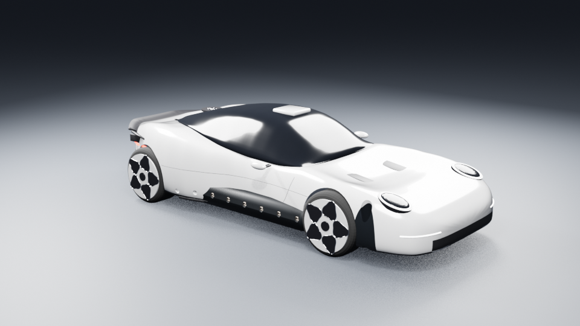

# Flying Mission S — 6DOF simulation and rendered demo

The current demo uses a quaternion 6DOF Simulink plant, three-axis flight computer,
and one geometry definition for simulation and Blender: `thruster_layout.json`.
The white Mission S body is a reference-informed reconstruction, not manufacturer CAD. Original reference photographs are not redistributed. All current outputs are in `out/revised/`.

[Watch the telemetry demo](out/revised/mission_s_telemetry.mp4)



## Results (October 16, 2026)

| Check | Result |
|---|---|
| Nominal full roll + backflip + landing | PASS |
| Barrel roll / backflip | -359.50° / +360.34° |
| Nominal minimum lineup clearance | 5.13 m |
| Nominal touchdown sink / tilt | 1.80 m/s / 0.057° |
| Lateral target / touchdown | 2.00 m / 2.00001 m |
| Nominal propellant used / remaining | 79.14 kg / 60.86 kg |
| Seeded 50-run Monte Carlo full stunt and landing | 50/50 PASS |
| MC worst touchdown sink / tilt | 1.99 m/s / 1.01° |
| MC minimum lineup clearance / remaining propellant | 4.04 m / 46.79 kg |
| Render geometry | 30 outlets, 28 command channels, zero protruding pods |
| Upright nozzle clearance | 0.212 m conservative geometry audit |

Published numerical evidence: `out/revised/scene.json`, `trajectory.csv`,
`monte_carlo.csv`, `loop_margins.csv`, and `robustness.json`.
Body views: `out/revised/body_review/`. Local recovery data, logs, private paths, raw workspace dumps, cached dependencies and reference photos are excluded from this public copy.

## Run

Windows prerequisites: MATLAB R2026a with Simulink, Control System Toolbox and
Optimization Toolbox (independent allocator verification); Blender 5.2.
Rendering was tested with NVIDIA OPTIX. The pipeline executable paths are configurable parameters.

```powershell
.\run_revised.ps1                 # validate, nominal, 50 runs, render, telemetry
.\run_revised.ps1 -SkipRender     # simulation and checks only
.\run_revised.ps1 -SkipMonteCarlo # nominal plus rendering
```

`run_v2.ps1` forwards to the revised pipeline. It stops when a required stage fails.
The Blender output is a PNG sequence; `matlab/telemetry_video.m` encodes the
1920×1080, 24 fps telemetry MP4. Renderer resolution is 1344×756, 64 samples with
denoising. The saved Blender scene is `out/revised/mission_s.blend`.

MATLAB commands:

```matlab
cd simulink
build_mission_s_model  % safely open/compile the checked-in revised .slx
ms_validate_plant
ms_validate_allocator
S = run_mission_s();   % authoritative trajectory + scene + plot
R = ms_robustness(50); % nominal controller, dispersed truth, seed 7
ms_debug_run(14)      % reproduce a particular dispersed run
addpath('../matlab')
telemetry_video('../out/revised');
```

The checked-in `simulink/mission_s.slx` is the model source. The build entry point
opens and compiles it without deleting or reconstructing it. MATLAB and Simulink
require commercial licenses; no vendor software or toolkits are bundled.
`matlab/mission_s_sim.m` forwards to the same model. The Blender scene can be
regenerated from the included trajectory and geometry; generated `.blend` files
are excluded to avoid embedding local workspace paths.

Explicit rendering:

```powershell
& 'C:\Program Files\Blender Foundation\Blender 5.2\blender.exe' -b -P blender/build_scene.py -- --render final --res 70 --samples 64 --frames_dir out/revised/frames --save out/revised/mission_s.blend
```

`--csv`, `--scene`, `--out`, `--still`, and `--frames` override defaults. The
renderer uses each row's scalar-first body-to-world quaternion and places the
body reference at `COM_world - R(q)*cg_body`; the exported x/y/z are instantaneous
COM coordinates. Every plume uses its canonical command channel and direction.

## Geometry and control

- Two 71 kN main chamber commands, each split equally between two short recessed
  outlets. Splitting does not double total thrust or propellant flow.
- Four integrated corner clusters, each retaining independent lift and counterjet
  ports, with 15° outboard exhaust cant and an assumed 3.9 kN per active direction.
- One row of eight 400 N jets per sill. Exhaust is outboard and 20° downward;
  reaction force is inward/upward. Individual jets permit yaw allocation.
- Two rear 400 N jets with assumed 5° outward exhaust cant, providing forward
  speed hold. Rear corner placements clear the tyres and tapered valance.
- Weighted bounded least squares allocates the remaining six-component wrench
  after main-chamber selection. Bounds can be released as the optimum changes.
  Forty feasible/infeasible targets were checked against independent `lsqlin`.
- The 200 Hz controller tracks quaternion attitude and roll/pitch/yaw body rates;
  thrust has pressure limits, per-channel lag and one-frame command latency.
  The plant integrates world translation, quaternion and body rates at 1 kHz,
  including gyroscopic coupling, full inertia tensor and tank-depletion Idot.

Raw telemetry retains all 28 channels. The video shows 14 bars: the 12 main,
corner and rear commands plus the mean of each eight-jet sill row. The labels
explicitly identify these means.

## Scope of the model

The car dimensions/powertrain, propulsion installation mass, tank placement,
corner counterjet ports, nozzle split and cant placements are concept assumptions.
The split outlets model shared thrust and render clearance; nozzle-flow,
combustion, plume heating, plumbing and structural feasibility are not solved.
Tank contents are fixed-position point masses without slosh. The chosen
variable-mass angular model retains Idot*w but omits a separate co-rotating
exhaust angular momentum flux model. Sensors are ideal; no wind, road roughness,
structural flexibility or valve faults are dispersed. Lineup vehicles are
approximate massing geometry. Fifty draws test the stated perturbations, not
all possible conditions.

Monte Carlo varies car mass (3% sigma), CG (5/2/2 cm sigma), three base inertia
scales (10% sigma, bounded), each channel thrust (3% sigma, bounded), Isp
(2% sigma, bounded), and lag (uniform ±30%). The controller retains nominal P.
A full-stunt pass requires actual approximately 360° roll/flip rotations,
landing from the landing-burn phase below 2.5 m/s and 10° tilt/yaw, positive
lineup/ground clearance, finite states and traversal beyond the lineup.
Local linear margins exclude saturation and full maneuver coupling.

Rear jets provide forward-only speed trim. In the nominal maneuver, world longitudinal speed ranges from 9.28 to 13.36 m/s around the 12 m/s setpoint; lateral target error at touchdown is approximately 0.00001 m. These are separate from the total 3D speed displayed in the video.

## Attribution

Independent concept study; not affiliated with or endorsed by Porsche, SpaceX, Tesla, MathWorks or Blender. Product names remain their owners' trademarks. Reference photographs and commercial software are not included. No redistribution license is granted beyond the repository host's standard viewing and forking permissions.
